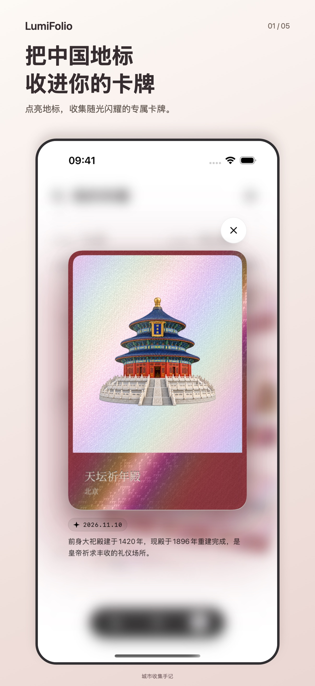
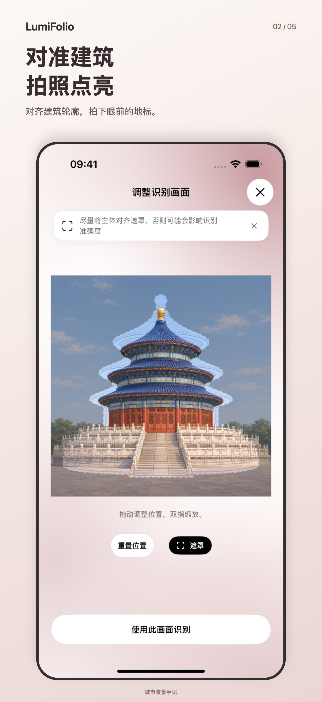
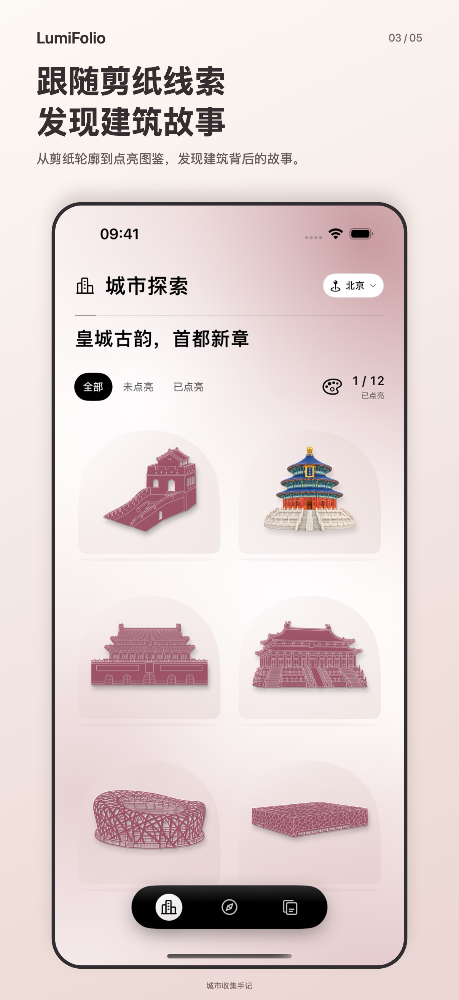

# LumiFolio

**把城市相遇，收进珍藏。**

LumiFolio 是一款中国地标建筑图鉴与拍照打卡 App，以中国剪纸为视觉灵感，把建筑、照片与城市记忆收进一册可翻阅的卡牌收藏。

探索北京、上海、深圳、香港与重庆的 62 处地标。从天坛祈年殿到现代城市天际线，无论你喜欢建筑、城市摄影，还是图鉴收藏，都可以按自己的节奏发现这些城市。

[在 App Store 查看](https://apps.apple.com/app/id6829957036) · [简体中文官网](https://superidoltheshawnroy.github.io/lumifolio-support/zh-Hans/index.html) · [English](https://superidoltheshawnroy.github.io/lumifolio-support/) · [繁體中文](https://superidoltheshawnroy.github.io/lumifolio-support/zh-Hant/index.html)

## 从发现，到珍藏

- **探索城市**：浏览剪纸风格的地标图鉴，阅读线索与文化小记；在漫游地图上寻找附近尚未点亮的地标。
- **拍照或到访点亮**：选择地标，拍摄照片或从相册选图，在设备上识别后点亮对应图鉴；到达附近时，也可选择定位打卡。
- **收藏地标卡牌**：欣赏随拖动或手机倾斜而变化的闪卡反光，用转盘和点亮时光浏览收藏，按城市筛选并回看首次点亮的日期。
- **按自己的节奏使用**：无需注册账号，支持简体中文、繁体中文和英文。照片在本机识别，收藏保存在设备上；定位权限可按需开启，地图需要网络。

## App 一览

以下为 LumiFolio 1.2（build 2）的 App Store 宣传图，包含功能说明与真实 App 截图。

  
  
  

## 支持与反馈

[使用帮助](https://superidoltheshawnroy.github.io/lumifolio-support/zh-Hans/support.html) · [隐私政策](https://superidoltheshawnroy.github.io/lumifolio-support/zh-Hans/privacy.html) · [使用条款](https://superidoltheshawnroy.github.io/lumifolio-support/zh-Hans/terms.html)

联系开发者：[superidoltheshawnroy@gmail.com](mailto:superidoltheshawnroy@gmail.com)。反馈时请说明 App 版本、iOS 版本、遇到的情况与预期结果。

## 关于此仓库

此仓库维护 LumiFolio 的官网、帮助、隐私政策和使用条款，通过 GitHub Pages 提供英文、简体中文及繁体中文页面。页面使用静态 HTML 和 CSS，无自设广告、统计脚本或外部字体。

- 根目录：英文页面。
- `zh-Hans/`：简体中文页面。`zh` 表示中文，`Hans` 表示简体汉字。
- `zh-Hant/`：繁体中文页面，`Hant` 表示繁体汉字。
- `assets/`：应用图标和公开宣传素材。

本仓库仅包含公开网站内容，不包含 iOS 应用源码或后台账户资料。
