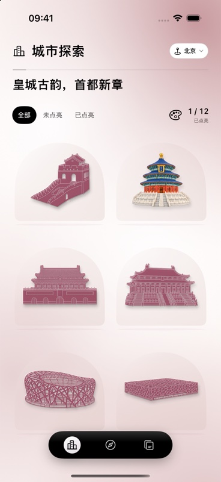
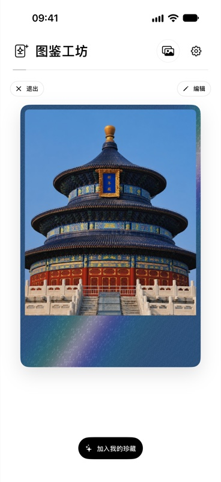
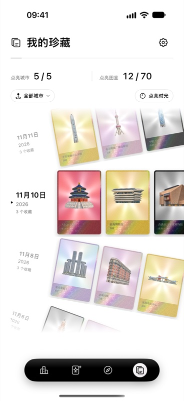

# LumiFolio

**把城市相遇，收进珍藏。**

LumiFolio 是一款中国地标建筑图鉴与拍照打卡 App，以中国剪纸为视觉灵感，把建筑、照片与城市记忆收进一册可翻阅的卡牌收藏。

探索北京、上海、深圳、香港与重庆的 62 处地标。从天坛祈年殿到现代城市天际线，无论你喜欢建筑、城市摄影，还是图鉴收藏，都可以按自己的节奏发现这些城市。

[在 App Store 查看](https://apps.apple.com/app/id6829957036) · [简体中文官网](https://superidoltheshawnroy.github.io/lumifolio-support/zh-Hans/index.html) · [English](https://superidoltheshawnroy.github.io/lumifolio-support/) · [繁體中文](https://superidoltheshawnroy.github.io/lumifolio-support/zh-Hant/index.html)

## 从发现到珍藏

- **拍照点亮，解锁剪纸**：循着剪纸轮廓找到地标，对准建筑拍照，让眼前的风景在图鉴中亮起来。
- **挑选照片，制作专属闪卡**：在图鉴工坊选一张喜欢的照片，定制边框、文字和水印，把自己的闪卡加入珍藏。
- **回看旅途的点亮时光**：在「我的珍藏」用转盘翻看闪卡，或切换到「点亮时光」，按日期回看旅途中点亮的地标。

  
  
  

## 支持与反馈

[使用帮助](https://superidoltheshawnroy.github.io/lumifolio-support/zh-Hans/support.html) · [隐私政策](https://superidoltheshawnroy.github.io/lumifolio-support/zh-Hans/privacy.html) · [使用条款](https://superidoltheshawnroy.github.io/lumifolio-support/zh-Hans/terms.html)

联系开发者：[superidoltheshawnroy@gmail.com](mailto:superidoltheshawnroy@gmail.com)。反馈时请说明 App 版本、iOS 版本、遇到的情况与预期结果。

## 关于此仓库

此仓库维护 LumiFolio 的官网、帮助、隐私政策和使用条款，通过 GitHub Pages 提供英文、简体中文及繁体中文页面。页面使用静态 HTML 和 CSS，无自设广告、统计脚本或外部字体。

- 根目录：英文页面。
- `zh-Hans/`：简体中文页面。`zh` 表示中文，`Hans` 表示简体汉字。
- `zh-Hant/`：繁体中文页面，`Hant` 表示繁体汉字。
- `assets/`：应用图标和公开宣传素材。

本仓库仅包含公开网站内容，不包含 iOS 应用源码或后台账户资料。
